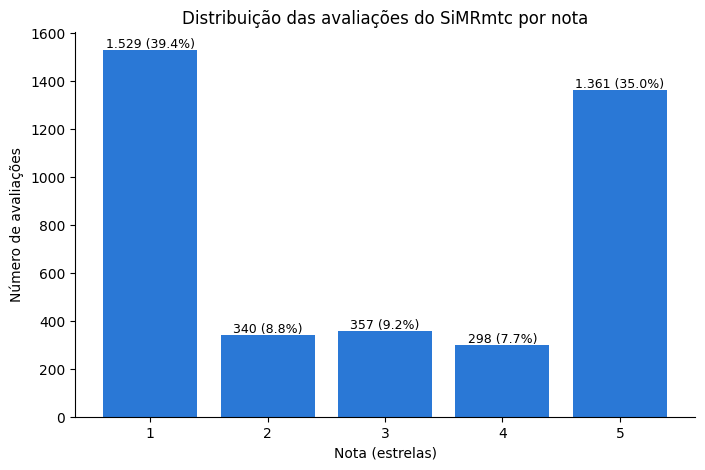
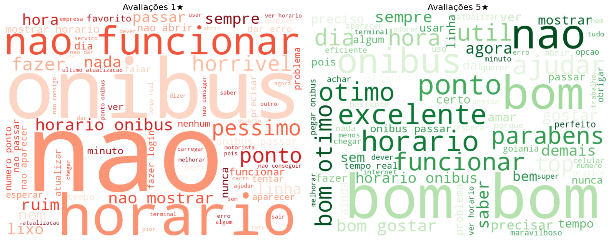

# O que os usuários dizem do SiMRmtc?

Análise das avaliações do aplicativo **SiMRmtc**, usado para acompanhar em tempo real os ônibus da Rede Metropolitana de Transportes Coletivos (RMTC) de Goiânia, publicadas na Google Play Store.

## Pergunta

Quais são os principais motivos de satisfação e de insatisfação dos usuários do app?

## Dados

- **3.885 avaliações** coletadas em novembro de 2026 com a biblioteca [`gplay-scraper`](https://github.com/Mohammedcha/gplay-scraper)
- Período: **março de 2015 a novembro de 2026**
- Campos usados: nota (1 a 5), texto, data, versão do app e votos de "útil"
- Nomes e fotos dos usuários **não** foram coletados

## Tratamento do texto

- **Lematização** com spaCy: cada palavra volta à forma de dicionário ("horários" → "horário", "funcionou" → "funcionar"), com correção manual dos lemas que o modelo erra
- Conversão para minúsculas e remoção de acentos, links, números, pontuação e emojis
- Remoção de *stopwords*, **mantendo as negações** ("não", "nunca", "nem"), porque "não funciona" e "funciona" têm sentidos opostos
- Remoção de palavras que aparecem em quase tudo e não dizem nada ("app", "aplicativo", "ter", "ficar")
- 39 avaliações ficaram sem texto útil (só emojis, "ok" etc.) e foram excluídas das análises de frequência, mas mantidas na análise das notas

## Resultados

### As notas são polarizadas

| Nota | Avaliações | % |
|---|---|---|
| 1★ | 1.529 | 39,4% |
| 2★ | 340 | 8,8% |
| 3★ | 357 | 9,2% |
| 4★ | 298 | 7,7% |
| 5★ | 1.361 | 35,0% |

Quase 3 em cada 4 avaliações estão nos extremos: os usuários ou aprovam ou rejeitam o app, com pouco meio-termo.

### O que se fala nas avaliações de 1★ e de 5★

### Os motivos das reclamações (pares de palavras mais comuns nas avaliações de 1★)

| Par de palavras | Ocorrências |
|---|---|
| não funcionar | 170 |
| horário ônibus | 112 |
| não mostrar | 105 |
| mostrar horário | 86 |
| não abrir | 86 |
| ônibus passar | 81 |
| dar erro | 68 |
| número ponto | 50 |
| fazer login | 50 |

<!-- Revise com as suas palavras -->
- **Reclamações:** o app não funciona ou não abre, o horário do ônibus não aparece ou não bate com a realidade, erros de login e dificuldade com o número do ponto.
- **Elogios:** a utilidade da informação em tempo real ("útil", "ajudar", "excelente").
- "Ônibus" e "horário" aparecem nos dois lados: são o **tema** do app, não o sentimento. O mesmo recurso que gera elogio quando funciona gera reclamação quando falha.

## Limitações

- Erros de digitação (ex.: "precido") não foram corrigidos e o lematizador ainda erra alguns casos
- Quem avalia na Play Store não representa todos os usuários do transporte coletivo
- Não há avaliações de iPhone (App Store)

## Próximos passos

- [ ] Evolução da nota ao longo do tempo e por versão do app
- [ ] TF-IDF
- [ ] Análise de sentimentos com BERTimbau (BERT em português)

## Como reproduzir

Abra o notebook no Colab pelo botão acima e execute todas as células. As bibliotecas estão em `requirements.txt`.

## Ferramentas

Python, pandas, spaCy, NLTK, Unidecode, WordCloud, Matplotlib e Google Colab.
Desenvolvido com apoio de IA (Claude) na estruturação e revisão do código.

---

**Lucas Soares** · Gestão da Informação (UFG)
